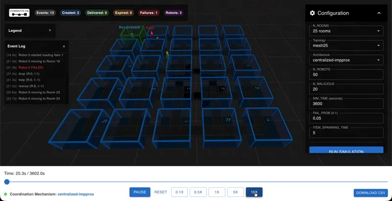

# COORDINATE 2.0

<p align="center">

</p>

<p align="center">
  
  
  <a href="https://hub.docker.com/r/ivancompd/coordinate-2.0"></a>
</p>

<p align="center">
  
  
  
</p>

## Overview

**COORDINATE 2.0** is a highly customizable discrete event simulator for Fault-Tolerant Multi-Agent Systems.

### Key Capabilities

- **Multiple Coordination Architectures**: Compare decentralized, semi-decentralized, and centralized coordination strategies
- **Realistic 3D Visualization**: Interactive environment with smooth animations and camera controls
- **Flexible Topology Support**: Simulate different hospital floor plans (mesh, line, custom layouts including real-world GUH73)
- **Comprehensive Analytics**: Real-time statistics, event logging, and CSV export for detailed analysis
- **Research-Ready**: Command-line batch processing for reproducible experiments

<p align="center">

</p>

---

## Quick Start

### Docker Deployment (Recommended)

The fastest way to get started. Pull and run the pre-built image from Docker Hub:

```bash
docker run -d -p 5002:5002 --name coordinate ivancompd/coordinate-2.0:latest
```

Then open **http://localhost:5002** in your browser.

**Docker Hub Repository:** [ivancompd/coordinate-2.0](https://hub.docker.com/r/ivancompd/coordinate-2.0)

### Local Development

For development or customization:

```bash
# 1. Setup backend
python3 -m venv .venv
source .venv/bin/activate  # On Windows: .venv\Scripts\activate
python -m pip install -r requirements.txt

# 2. Start backend (Terminal 1)
python -m backend.app

# 3. Start frontend (Terminal 2)
cd ui
npm install
npm run dev
```

Access the application at **http://localhost:5173**

> **Note:** Backend runs on port 5002, frontend on port 5173

---

## Paper Experiment Campaign

This is the workflow to use on the machines used for the paper experiments.
The repository tracks the compact CSV files needed for campaign resume, paper
tables, and notebook figures. Large raw traces and transient logs are not
tracked.

### First Setup

From the project root, the easiest setup is:

```bash
bash scripts/setup_experiments.sh
source .venv/bin/activate
```

The setup script creates `.venv`, installs the Python dependencies used by the
experiment runners and notebook, and tries to install a machine-compatible
`rtlola-cli` inside the virtual environment. If a compatible bundled binary is
already present in the repository, it is reused; otherwise the installer falls
back to Cargo.

If you prefer a different environment name such as `venv`, the setup script can
reuse or create it directly:

```bash
VENV_DIR=venv bash scripts/setup_experiments.sh
source venv/bin/activate
```

If you already recreated and activated the environment manually, run:

```bash
python -m pip install --upgrade pip
python -m pip install -r requirements.txt
bash scripts/install_rtlola_venv.sh
python scripts/check_rtlola.py
```

`python scripts/check_rtlola.py` must find a usable `rtlola-cli` before running
Dynamic Adaptation experiments.

### After Pulling Results

After a `git pull`, the compact result CSVs in `Paper Results/RQ*` are available
locally. The runners use those CSVs to resume completed experiments, so already
completed repetitions are skipped automatically.

To extend the current 5-repetition campaign to 10 repetitions, run:

```bash
source .venv/bin/activate
python "Paper Results/run_full_paper_campaign.py"
```

The default campaign is already configured for the paper:

- RQ1 runs `CE`, `SD`, `FD`, and `DA`.
- RQ2 runs `DA`.
- RQ3 runs `CE`, `SD`, `FD`, and `DA`.
- RQ4 runs `CE` and `DA` for the current hardware profile.

On Linux, RQ4 is labeled as `workstation`. On macOS, RQ4 is labeled as `mac`.
Therefore, to complete both RQ4 hardware profiles, run the same command once on
the workstation and once on the Mac.

To leave the campaign running after closing the terminal:

```bash
nohup python -u "Paper Results/run_full_paper_campaign.py" >/dev/null 2>&1 &
```

To check progress:

```bash
tail -f "Paper Results/campaign_status.csv"
```

To regenerate the paper figures from the committed CSVs:

```bash
jupyter notebook "Paper Results/paper_results_plots.ipynb"
```

The notebook writes PDF figures to `Paper Results/paper_figures/`.

---

## Features

### 🎮 Interactive 3D Visualization

- **Realistic Environment**: Rooms, corridors, and transparent glass walls rendered with React Three Fiber
- **Animated Robots**: 3D robot models with smooth movement, pickup/delivery animations, and status indicators
- **Camera Controls**: 
  - Left-click + drag to rotate
  - Right-click + drag to pan
  - Scroll to zoom
- **Playback Controls**: Variable speed (0.1x to 10x), pause, play, reset, and timeline scrubbing

### 🤖 Coordination Architectures

| Architecture | Description |
|--------------|-------------|
| **Decentralized** | Robots make independent decisions without communication |
| **Semi-Decentralized** | Robots share information with nearby peers |
| **Centralized-Proximity** | Central coordinator assigns tasks based on robot-item distance |
| **Centralized-Importance** | Central coordinator prioritizes high-importance items |
| **Centralized-ProxImp** | Proximity-first, then importance tiebreaker |
| **Centralized-ImpProx** | Importance-first, then proximity tiebreaker |
| **Dynamic-Adaptation** | 🆕 **Adaptive coordination that learns online when to switch strategies at runtime** |

#### Dynamic-Adaptation Architecture

The dynamic-adaptation architecture monitors recent runtime indicators and uses
a conservative contextual bandit to learn online which coordination mechanism is
expected to perform best in the current operating context. The default policy
chooses among `centralized-impprox` (CE), `semi-decentralized` (SD), and
`decentralized` (FD). The context uses observed arrivals, robot failures,
network probes, and suspicious signals. The reward uses completion among
terminal tasks, relative delivery latency, or both, depending on the objective.

The bandit starts by observing the configured initial architecture. An update
requires enough evidence for the selected objective and a complete observation
window under the action. RTLola samples the rolling window every ten simulated
seconds. The runtime uses the timestamp of that sample when checking whether
the feedback window is complete. The reward uses the current window's latency.
The smoothed latency is available in the trace and resets when observations are
missing.

When enough tasks reach a terminal state and all of them expire, latency
quality is zero for latency-based objectives.

DA uses a shorter RTLola window to detect service degradation and a longer
window to observe reward under the active mechanism. It keeps that mechanism
while the service meets its targets or the evidence is insufficient. The
bandit compares the best alternative to the active mechanism's measured
reward, including the switch cost and improvement margin. A previously
tried alternative must also offer a gain in expected reward when reacting
to latency. Returning to the previous mechanism for latency is deferred
for three feedback periods by default. Completion below target in both
windows can trigger reassessment after the first full feedback period.

Fault phases change simulator parameters at the start of each interval.
Gaps use the baseline parameters. A change in the arrival interval applies
from the boundary, including the remaining time until the next arrival.
Exponential arrivals use the integrated rate, and trace-based arrivals follow
their recorded times. Movement, repair, and communication already scheduled
retain their scheduled completion times. The adaptation policy receives
observed runtime metrics and has no access to the calendar of phases.

**Configuration Parameters:**
- `INITIAL_ARCHITECTURE`: Starting strategy (default: `semi-decentralized`)
- `ADAPTATION_CHECK_INTERVAL`: Minimum interval between checks in simulated seconds (default: 300)
- `ADAPTATION_WINDOW`: Minimum rolling feedback duration in simulated seconds (default: 3600)
- `ADAPTATION_SERVICE_WINDOW`: RTLola service detection window in seconds (default: half the rolling feedback duration)
- `ADAPTATION_PERSISTENCE_CHECKS`: Consecutive degraded observations required before considering a switch (default: 2)
- `BANDIT_FEEDBACK_WINDOW`: Duration of the rolling reward and context aggregates, at least `ADAPTATION_WINDOW`. Decisions also wait at least one check interval under the active mechanism.
- `ADAPTATION_LATENCY_REASSESSMENT_TIME`: Minimum time before a return driven by latency or unconfirmed completion degradation (default: three feedback periods). Zero disables the return wait and the extra expected-gain check.
- `ADAPTATION_POLICY`: Adaptation policy (default: `contextual-bandit`)
- `BANDIT_OBJECTIVE_MODE`: `completion-only`, `latency-only`, `weighted`, or `completion-constrained` (default)
- `BANDIT_COMPLETION_WEIGHT`: Completion weight in the weighted objective (default: 0.5)
- `BANDIT_COMPLETION_TARGET`: Minimum acceptable completion rate among terminal tasks (default: 0.65)
- `LATENCY_THRESHOLD_HIGH`: Maximum acceptable mean relative delivery latency in seconds (default: 40)
- `BANDIT_MIN_TERMINAL_OUTCOMES`: Minimum terminal task count for completion feedback or confirmed failure to deliver (default: 3)
- `BANDIT_IMPROVEMENT_MARGIN`: Minimum estimated reward gain after the switch cost (default: 0.02)
- `BANDIT_SWITCH_PENALTY`: Selection cost applied when considering a switch (default: 0.03)

Custom RTLola specifications mark feedback aggregates with
`// coordinate-adaptation-window` and the three service detection aggregates
with `// coordinate-service-window`, as in `spec2.rtlola`.

**Centralized Coordination Parameters:**
- `COORDINATOR_SERVICE_TIME`: Deterministic time required by the central coordinator to process one rescue request; concurrent requests wait in a FIFO service queue (default: `0.0`).
- `COORDINATOR_COMMAND_LOSS_PROB`: Probability that the coordinator-to-helper command is lost. Set to `-1.0` to reuse `COMM_FAIL_PROB` for both communication hops (default: `-1.0`).

Centralized rescue coordination models an agent-to-coordinator message, coordinator service time, and a coordinator-to-helper command. Both communication hops are subject to their configured delay and loss probability.

Architecture switches are logged in the CSV output with event type `switch_architecture_{new_arch}`.

### 📊 Analytics & Export

- **Real-time Statistics**: Track deliveries, failures, and system performance
- **Event Log**: Detailed timeline of all robot actions and item states
- **CSV Export**: Download complete simulation results for external analysis
- **Item Importance Levels**: Low (L), Medium (M), High (H) priority classification

### 🏥 Topology Support

- **Mesh Layouts**: `mesh25`, `mesh16`, `mesh9` - Grid-based hospital floors
- **Linear Layouts**: `line10`, `line5` - Corridor-style environments
- **Custom Layouts**: `GUH73` - Real-world Gent University Hospital floor plan
- **Configurable**: Define custom topologies in `env_maps.py`

---

## Installation & Deployment

### Prerequisites

- **Python** 3.12+
- **Node.js** 14+ (for local frontend development)
- **Docker** (optional, for containerized deployment)
- **Rust & RTLola** (required for Dynamic Adaptation)

### RTLola Setup

Dynamic Adaptation requires the `rtlola-cli` binary because runtime monitoring
is implemented through the RTLola specification in `spec2.rtlola`. The normal
setup path installs RTLola inside the project virtual environment:

```bash
bash scripts/setup_experiments.sh
source .venv/bin/activate
python scripts/check_rtlola.py
```

If the virtual environment already exists, install or repair only RTLola with:

```bash
bash scripts/install_rtlola_venv.sh
python scripts/check_rtlola.py
```

The installer uses Rust/Cargo when needed and installs `rtlola-cli` version
`0.1.2` into `.venv/bin/rtlola-cli`. The checker reports the candidate binaries
considered by the simulator and the selected executable. A working setup should
show:

```bash
rtlola-cli 0.1.2
```

The simulator uses `spec2.rtlola` by default through the `RTLOLA_SPEC_FILE`
configuration parameter. The UI RTLola editor also reads and writes this file
directly, so it does not create timestamped custom specification files.

Useful Dynamic Adaptation parameters are:

| Parameter | Default | Description |
|-----------|---------|-------------|
| `RTLOLA_SPEC_FILE` | `spec2.rtlola` | RTLola specification used by the monitor |
| `RTLOLA_BINARY_PATH` | auto-detected | Optional explicit path to `rtlola-cli` |
| `INITIAL_ARCHITECTURE` | `semi-decentralized` | Coordination mechanism active at startup |
| `ADAPTATION_CHECK_INTERVAL` | `300.0` | Simulated seconds between adaptation decisions |
| `ADAPTATION_POLICY` | `contextual-bandit` | Online adaptation policy |

For debugging, the monitor can be invoked manually:

```bash
.venv/bin/rtlola-cli monitor --stdin spec2.rtlola --online -v outputs
```

If Dynamic Adaptation fails with a missing RTLola error, rerun
`bash scripts/install_rtlola_venv.sh` and then `python scripts/check_rtlola.py`.

### Docker Options

**Option 1: Pull from Docker Hub**
```bash
docker pull ivancompd/coordinate-2.0:latest
docker run -p 5002:5002 ivancompd/coordinate-2.0:latest
```

**Option 2: Build Locally**
```bash
docker build -t coordinate-2.0 .
docker run -p 5002:5002 coordinate-2.0
```

**Option 3: Docker Compose (with persistence)**
```bash
docker-compose up -d
```

**Option 4: Custom Volume Mounts**
```bash
docker run -d -p 5002:5002 \
  -v $(pwd)/results:/app/results \
  -v $(pwd)/configuration:/app/configuration \
  --name coordinate \
  ivancompd/coordinate-2.0:latest
```

> **Tip:** Use volume mounts to persist simulation results and configurations between container restarts.

---

## Usage Guide

### Web Interface

1. **Open Configuration**: Click the gear icon in the top-right corner
2. **Select Architecture**: Choose from decentralized, semi-decentralized, or centralized variants
3. **Choose Topology**: Select a hospital floor plan (mesh25, GUH73, etc.)
4. **Configure Parameters**:
   - Number of robots
   - Simulation time
   - Item spawning rate and distribution
   - Failure probabilities
   - Robot timing parameters
5. **Run Simulation**: Click "Run Simulation" and wait for completion
6. **Interact with Visualization**:
   - Use playback controls to adjust speed
   - Navigate the 3D view with mouse controls
   - Monitor real-time statistics in the side panel
   - View detailed event log
7. **Export Results**: Click "Download CSV" to save simulation data

### Command-Line Simulation

#### Method 1: Paper Campaign

Run the current paper campaign through the maintained RQ runners:

```bash
python "Paper Results/run_full_paper_campaign.py"
```

This resumes from the compact CSV files in `Paper Results/RQ*` and skips runs
that are already completed.

#### Method 2: Custom Configuration File

Create a JSON configuration file (e.g., `my_config.json`):

```json
{
  "RESULTS_DIR": "results",
  "SIM_TIME": 3600,
  "ARCHITECTURE": "centralized-impprox",
  "TOPOLOGY_NAME": "mesh25",
  "N_ROOMS": 25,
  "SOURCE": 0,
  "TARGETS": -1,
  "ITEM_SPAWNING_TIME": 120,
  "ITEM_SPAWNING_DISTR": "exponential",
  "IMPORTANCE_PROBABILITIES": [0.5, 0.1, 0.4],
  "EXPIRATION_TIME": [-1, -1, -1],
  "N_ROBOTS": 20,
  "N_MALICIOUS": 0,
  "FAIL_PROB": 0.05,
  "COMM_FAIL_PROB": 0.003,
  "LOAD_TIME": 1.0,
  "MOVEMENT_TIME": 5.0,
  "DROP_TIME": 1.0,
  "COMP_TIME": 0.1,
  "COMM_TIME": 0.03,
  "RECOVERY_TIME": 1800.0
}
```

Run the simulation:
```bash
python -m sim.simulator my_config.json
```

Results are saved as CSV in the `results/` directory.

---

## Configuration Parameters

| Parameter | Description | Example Values |
|-----------|-------------|----------------|
| `SIM_TIME` | Simulation duration (seconds) | `3600` |
| `ARCHITECTURE` | Coordination strategy | `centralized-impprox` |
| `TOPOLOGY_NAME` | Hospital floor plan | `mesh25`, `GUH73` |
| `N_ROBOTS` | Number of robots | `20` |
| `ITEM_SPAWNING_TIME` | Average time between item spawns | `120` |
| `ITEM_SPAWNING_DISTR` | Spawning distribution | `exponential`, `uniform` |
| `IMPORTANCE_PROBABILITIES` | [Low, Medium, High] probabilities | `[0.5, 0.1, 0.4]` |
| `FAIL_PROB` | Robot failure probability | `0.05` |
| `COMM_FAIL_PROB` | Communication failure probability | `0.003` |
| `MOVEMENT_TIME` | Time to move between adjacent rooms | `5.0` |
| `RECOVERY_TIME` | Time to rescue a failed robot | `1800.0` |

---

## License

This project is licensed under the MIT License - see the [LICENSE](LICENSE) file for details.

---
