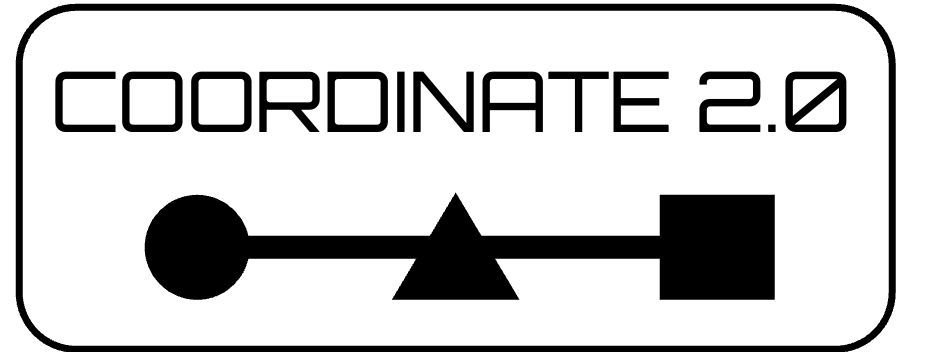

# COORDINATE 2.0

<p align="center">

</p>

<p align="center">
  
  
  <a href="https://hub.docker.com/r/ivancompd/coordinate-2.0"></a>
</p>

<p align="center">
  
  
  
</p>

## Overview

**COORDINATE 2.0** is a highly customizable discrete event simulator for Fault-Tolerant Multi-Agent Systems.

### Key Capabilities

- **Multiple Coordination Architectures**: Compare decentralized, semi-decentralized, and centralized coordination strategies
- **Realistic 3D Visualization**: Interactive environment with smooth animations and camera controls
- **Flexible Topology Support**: Simulate different hospital floor plans (mesh, line, custom layouts including real-world GUH73)
- **Comprehensive Analytics**: Real-time statistics, event logging, and CSV export for detailed analysis
- **Research-Ready**: Command-line batch processing for reproducible experiments

<p align="center">

</p>

---

## Quick Start

### Docker Deployment (Recommended)

The fastest way to get started. Pull and run the pre-built image from Docker Hub:

```bash
docker run -d -p 5002:5002 --name coordinate ivancompd/coordinate-2.0:latest
```

Then open **http://localhost:5002** in your browser.

**Docker Hub Repository:** [ivancompd/coordinate-2.0](https://hub.docker.com/r/ivancompd/coordinate-2.0)

### Local Development

For development or customization:

```bash
# 1. Setup backend
python3 -m venv venv
source venv/bin/activate  # On Windows: venv\Scripts\activate
pip install flask flask-cors numpy

# 2. Start backend (Terminal 1)
python -m backend.app

# 3. Start frontend (Terminal 2)
cd ui
npm install
npm run dev
```

Access the application at **http://localhost:5173**

> **Note:** Backend runs on port 5002, frontend on port 5173

---

## Features

### 🎮 Interactive 3D Visualization

- **Realistic Environment**: Rooms, corridors, and transparent glass walls rendered with React Three Fiber
- **Animated Robots**: 3D robot models with smooth movement, pickup/delivery animations, and status indicators
- **Camera Controls**: 
  - Left-click + drag to rotate
  - Right-click + drag to pan
  - Scroll to zoom
- **Playback Controls**: Variable speed (0.1x to 10x), pause, play, reset, and timeline scrubbing

### 🤖 Coordination Architectures

| Architecture | Description |
|--------------|-------------|
| **Decentralized** | Robots make independent decisions without communication |
| **Semi-Decentralized** | Robots share information with nearby peers |
| **Centralized-Proximity** | Central coordinator assigns tasks based on robot-item distance |
| **Centralized-Importance** | Central coordinator prioritizes high-importance items |
| **Centralized-ProxImp** | Proximity-first, then importance tiebreaker |
| **Centralized-ImpProx** | Importance-first, then proximity tiebreaker |
| **Dynamic-Adaptation** | 🆕 **Adaptive coordination that switches strategies at runtime based on latency metrics** |

#### Dynamic-Adaptation Architecture

The dynamic-adaptation architecture monitors delivery latency in real-time and automatically switches between coordination strategies to optimize performance:

- **High Latency** (> threshold): Switches to `decentralized` to reduce coordination overhead
- **Low Latency** (< threshold): Switches to `centralized-impprox` for optimal task allocation  
- **Medium Latency**: Uses `semi-decentralized` for balanced performance

**Configuration Parameters:**
- `INITIAL_ARCHITECTURE`: Starting strategy (default: `semi-decentralized`)
- `ADAPTATION_CHECK_INTERVAL`: How often to check metrics in seconds (default: 300)
- `LATENCY_THRESHOLD_LOW`: Switch to centralized if below this (default: 100)
- `LATENCY_THRESHOLD_HIGH`: Switch to decentralized if above this (default: 300)

Architecture switches are logged in the CSV output with event type `switch_architecture_{new_arch}`.

### 📊 Analytics & Export

- **Real-time Statistics**: Track deliveries, failures, and system performance
- **Event Log**: Detailed timeline of all robot actions and item states
- **CSV Export**: Download complete simulation results for external analysis
- **Item Importance Levels**: Low (L), Medium (M), High (H) priority classification

### 🏥 Topology Support

- **Mesh Layouts**: `mesh25`, `mesh16`, `mesh9` - Grid-based hospital floors
- **Linear Layouts**: `line10`, `line5` - Corridor-style environments
- **Custom Layouts**: `GUH73` - Real-world Gent University Hospital floor plan
- **Configurable**: Define custom topologies in `env_maps.py`

---

## Installation & Deployment

### Prerequisites

- **Python** 3.12+
- **Node.js** 14+ (for local frontend development)
- **Docker** (optional, for containerized deployment)
- **Rust & RTLola** (required for Dynamic Adaptation)

### Installing RTLola

To use the **Dynamic-Adaptation** architecture, you need the `rtlola-cli` binary.

**Option 1: Install via Cargo (Recommended)**

1. **Install Rust** (if not already installed):
   ```bash
   curl --proto '=https' --tlsv1.2 -sSf https://sh.rustup.rs | sh
   ```

2. **Install RTLola CLI**:
   ```bash
   cargo install rtlola-cli
   ```

3. **Verify Installation**:
   ```bash
   rtlola-cli --version
   ```

**Option 2: Copy Binary (No Installation Required)**

If you have `rtlola-cli` on another machine, simply copy it to the project directory:

```bash
# Copy the binary to the COORDINATE-2.0 folder
cp /path/to/rtlola-cli /path/to/COORDINATE-2.0/

# Make it executable (Linux/Mac)
chmod +x rtlola-cli
```

The system will automatically detect the binary in the project directory.

### Docker Options

**Option 1: Pull from Docker Hub**
```bash
docker pull ivancompd/coordinate-2.0:latest
docker run -p 5002:5002 ivancompd/coordinate-2.0:latest
```

**Option 2: Build Locally**
```bash
docker build -t coordinate-2.0 .
docker run -p 5002:5002 coordinate-2.0
```

**Option 3: Docker Compose (with persistence)**
```bash
docker-compose up -d
```

**Option 4: Custom Volume Mounts**
```bash
docker run -d -p 5002:5002 \
  -v $(pwd)/results:/app/results \
  -v $(pwd)/configuration:/app/configuration \
  --name coordinate \
  ivancompd/coordinate-2.0:latest
```

> **Tip:** Use volume mounts to persist simulation results and configurations between container restarts.

---

## Usage Guide

### Web Interface

1. **Open Configuration**: Click the gear icon in the top-right corner
2. **Select Architecture**: Choose from decentralized, semi-decentralized, or centralized variants
3. **Choose Topology**: Select a hospital floor plan (mesh25, GUH73, etc.)
4. **Configure Parameters**:
   - Number of robots
   - Simulation time
   - Item spawning rate and distribution
   - Failure probabilities
   - Robot timing parameters
5. **Run Simulation**: Click "Run Simulation" and wait for completion
6. **Interact with Visualization**:
   - Use playback controls to adjust speed
   - Navigate the 3D view with mouse controls
   - Monitor real-time statistics in the side panel
   - View detailed event log
7. **Export Results**: Click "Download CSV" to save simulation data

### Command-Line Simulation

#### Method 1: Benchmark Experiments

Run the predefined experiments from the research paper:

```bash
python -m experiments.run_all_experiments
```

This executes multiple simulations with varying parameters for comparative analysis.

#### Method 2: Custom Configuration File

Create a JSON configuration file (e.g., `my_config.json`):

```json
{
  "RESULTS_DIR": "results",
  "SIM_TIME": 3600,
  "ARCHITECTURE": "centralized-impprox",
  "TOPOLOGY_NAME": "mesh25",
  "N_ROOMS": 25,
  "SOURCE": 0,
  "TARGETS": -1,
  "ITEM_SPAWNING_TIME": 120,
  "ITEM_SPAWNING_DISTR": "exponential",
  "IMPORTANCE_PROBABILITIES": [0.5, 0.1, 0.4],
  "EXPIRATION_TIME": [-1, -1, -1],
  "N_ROBOTS": 20,
  "N_MALICIOUS": 0,
  "FAIL_PROB": 0.05,
  "COMM_FAIL_PROB": 0.003,
  "LOAD_TIME": 1.0,
  "MOVEMENT_TIME": 5.0,
  "DROP_TIME": 1.0,
  "COMP_TIME": 0.1,
  "COMM_TIME": 0.03,
  "RECOVERY_TIME": 1800.0
}
```

Run the simulation:
```bash
python -m sim.simulator my_config.json
```

Results are saved as CSV in the `results/` directory.

---

## Configuration Parameters

| Parameter | Description | Example Values |
|-----------|-------------|----------------|
| `SIM_TIME` | Simulation duration (seconds) | `3600` |
| `ARCHITECTURE` | Coordination strategy | `centralized-impprox` |
| `TOPOLOGY_NAME` | Hospital floor plan | `mesh25`, `GUH73` |
| `N_ROBOTS` | Number of robots | `20` |
| `ITEM_SPAWNING_TIME` | Average time between item spawns | `120` |
| `ITEM_SPAWNING_DISTR` | Spawning distribution | `exponential`, `uniform` |
| `IMPORTANCE_PROBABILITIES` | [Low, Medium, High] probabilities | `[0.5, 0.1, 0.4]` |
| `FAIL_PROB` | Robot failure probability | `0.05` |
| `COMM_FAIL_PROB` | Communication failure probability | `0.003` |
| `MOVEMENT_TIME` | Time to move between adjacent rooms | `5.0` |
| `RECOVERY_TIME` | Time to rescue a failed robot | `1800.0` |

---

## License

This project is licensed under the MIT License - see the [LICENSE](LICENSE) file for details.

---
